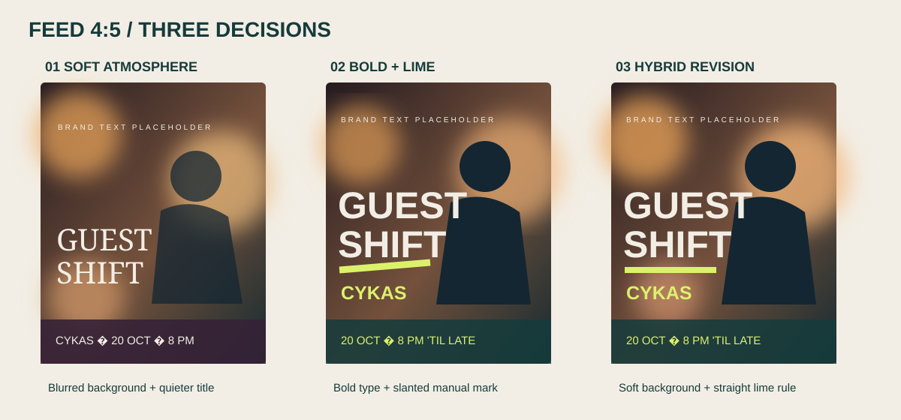
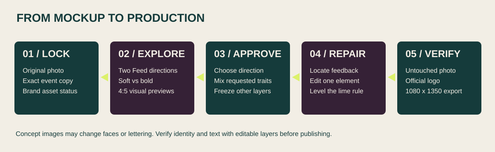

# Case study: The Botanist Gin Guest Shift at CYKAS

This documents a design test and its feedback. The artwork was a **concept mockup**, not a verified production poster. The official brand logo had not been placed, and the generated person could differ from the original photo.

## Brief and fixed facts

| Requirement | Decision |
|---|---|
| Format | Instagram Feed 4:5 first; adapt Story only after Feed approval |
| Subject | Supplied real photograph of a smiling bartender shaking a stainless shaker in an amber-lit bar |
| Copy | `THE BOTANIST GIN` / `GUEST SHIFT` / `CYKAS` / `20 OCTOBER` / `8 PM ’TIL LATE` |
| Branding | Keep the official Botanist logo's original form and color; use temporary plain text if the asset is unavailable |
| Accent | Playbook acid lime `#DCF16B` for event information, cream `#F2EEE5` for headline, deep teal `#153B3B` for the supporting band |
| Guardrail | Photo-first realism: protect portrait, pose, clothing, shaker and photographic texture |

## What happened

1. The user requested **two visual options** and said Instagram Feed was primary. Option 1 used a soft, hazy editorial background and elegant treatment. Option 2 used bold condensed typography, teal information band and acid lime punctuation.
2. Story variants were generated prematurely before Feed approval. This was a sequencing error. The user chose **Option 2** for the Feed.
3. The user then asked to **combine** Option 1's softly blurred atmosphere with Option 2's acid lime palette. A new 4:5 mockup used the bartender portrait, large `GUEST SHIFT`, lime accents and event facts.
4. The user marked a region around **x 26.4%, y 58.1%**, saying the image looked too synthetic. A model edit attempted to clean the junction of photo, typography and accent. The result remained a generated mockup: it did not prove pixel-level preservation of the source photograph.
5. The user identified a **diagonally rising lime underline** under `SHIFT`. This was a chosen brushstroke gesture that conflicted with the desired clean layout. The following revision made it straight and horizontal.

## What worked and what did not

| Worked | Did not work / lesson |
|---|---|
| A/B previews made the visual choice concrete. | Creating Story before approval ignored the agreed Feed-first gate. |
| Combining a soft photographic atmosphere and acid lime gave the user a specific direction to critique. | Generative edits can alter an identifiable person's appearance; a prompt alone cannot guarantee exact photo preservation. |
| Coordinate feedback narrowed the target to a small region. | The first region cleanup left the brushstroke's diagonal direction untouched because that issue was only made explicit in the next message. |
| A direct correction of the underline produced a clean horizontal rule. | A hand-drawn gesture from the print system was not appropriate for a precise nightlife information poster. |
| Canva held candidate RGB logo artwork for The Botanist. | Plain `THE BOTANIST GIN` type was not the official logo; the mockup must say so. |

## Reusable decision

Use the original photograph as the production layer, do exact typography and logo placement with editable layers, and reserve image generation for mood exploration. On each revision, check whether only the requested local feature changed. If a user wants full-color photo plus acid lime event text, honor that explicit brief instead of forcing the default mono-color print limitation.

The visual below is a **schematic**, not the bartender's actual photograph and not an official brand asset. It deliberately avoids publishing a private person's face in this public repository.

